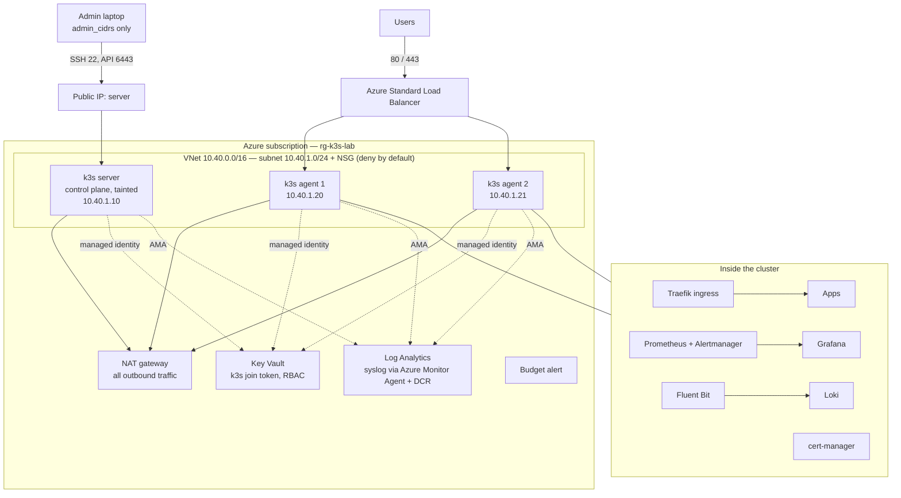

# Architecture

## Layers
| Layer | Tool | What it does |
|---|---|---|
| Infrastructure | Terraform (azurerm 4) | VNet, NSG, NAT gateway, Load Balancer, 3 VMs (Trusted Launch), Key Vault, Log Analytics, DCR, budget |
| First boot | cloud-init | patches, no password login, no root login |
| Configuration | Ansible | OS hardening, k3s server and agents, platform charts |
| Platform | Helm (via Ansible) | cert-manager, kube-prometheus-stack, Loki, Fluent Bit, alert rules |
| Delivery | GitHub Actions | fmt/validate/tflint/Trivy → plan on PR → apply after approval; nightly drift check; ansible-lint |

## Network rules
- Inbound from the internet: only 80/443 to the load balancer (agents run the Traefik ingress).
- SSH (22) and the Kubernetes API (6443): only from `admin_cidrs`, only on the server's public IP.
  Agents have no public IP; Ansible reaches them through the server (`ProxyJump`).
- Outbound: one NAT gateway (fixed egress IP, no default outbound access on the subnet).
- Pod-to-pod traffic between nodes is encrypted (`flannel-backend: wireguard-native`).

## Cost (West Europe, pay-as-you-go, about)
3 × B2s VMs ≈ 3 × €33, NAT gateway ≈ €32 + traffic, Standard LB ≈ €18, 3 public IPs ≈ €10, disks ≈ €15,
Log Analytics (1 GB/day cap) a few €. About **€150–180 per month** if it runs all the time.
`terraform destroy` after a demo, or deallocate the VMs; the budget alert warns at 80 % of `monthly_budget`.
